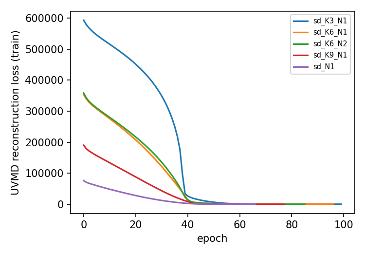
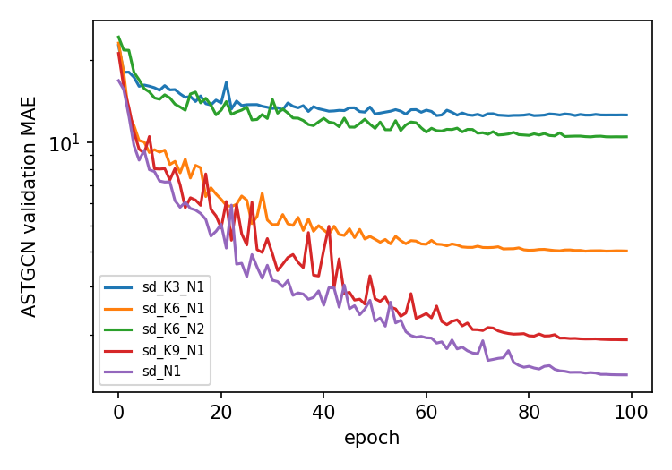
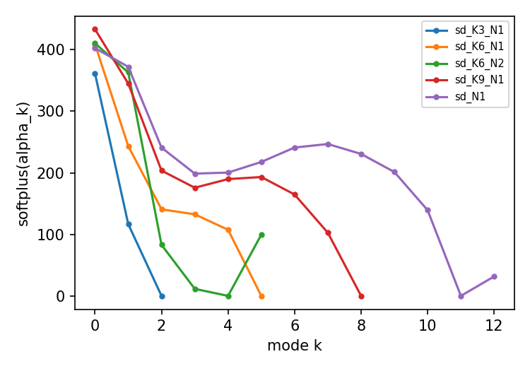

# MAGN replication, paper-style report

Generated by `replication/scripts/paper_report.py` from the logs in this folder. Paper numbers: arXiv:2509.00703v1.

## Table I: MAGN (UVMD K=13, N=1 + ASTGCN), paper vs replicated

Units as in the paper: MAPE in %. ASTGCN* rows are the paper's numbers for the plain ASTGCN (not rerun).

### GBA

| row | Param | H3 MAE | RMSE | MAPE | H6 MAE | RMSE | MAPE | H12 MAE | RMSE | MAPE | Avg MAE | RMSE | MAPE |
|---|---|---|---|---|---|---|---|---|---|---|---|---|---|
| ASTGCN* (paper, not rerun) | - | 21.40 | 33.61 | 17.65% | 26.70 | 40.75 | 24.02% | 33.64 | 51.21 | 31.15% | 26.15 | 40.25 | 23.29% |
| MAGN (paper) | 140.174K+22.38M | 0.62 | 0.93 | 0.68% | 0.68 | 1.09 | 0.74% | 2.00 | 4.71 | 1.90% | 0.86 | 1.63 | 0.91% |
| MAGN (replicated) | not run yet | |

### GLA

| row | Param | H3 MAE | RMSE | MAPE | H6 MAE | RMSE | MAPE | H12 MAE | RMSE | MAPE | Avg MAE | RMSE | MAPE |
|---|---|---|---|---|---|---|---|---|---|---|---|---|---|
| ASTGCN* (paper, not rerun) | - | 21.11 | 32.41 | 11.82% | 27.80 | 44.67 | 17.79% | 39.39 | 59.31 | 28.03% | 28.12 | 44.40 | 18.62% |
| MAGN (paper) | 140.173K+59.2M | 0.67 | 3.16 | 0.62% | 0.74 | 4.30 | 0.67% | 2.73 | 17.71 | 1.89% | 1.11 | 6.53 | 0.92% |
| MAGN (replicated) | not run yet | |

### SD

| row | Param | H3 MAE | RMSE | MAPE | H6 MAE | RMSE | MAPE | H12 MAE | RMSE | MAPE | Avg MAE | RMSE | MAPE |
|---|---|---|---|---|---|---|---|---|---|---|---|---|---|
| ASTGCN* (paper, not rerun) | - | 19.68 | 31.53 | 12.20% | 24.45 | 38.89 | 15.36% | 31.52 | 49.77 | 22.15% | 26.07 | 38.42 | 15.63% |
| MAGN (paper) | 140.173K+2.17M | 0.84 | 1.88 | 0.84% | 0.90 | 2.23 | 0.92% | 3.60 | 8.49 | 2.97% | 1.38 | 3.30 | 1.28% |
| **MAGN (replicated, 1 seed)** | 140.173K+2.16M | 0.85 | 1.51 | 0.89% | 0.93 | 1.75 | 0.96% | 3.83 | 7.11 | 3.12% | 1.44 | 2.77 | 1.34% |
| relative difference | | +1% | -19% | +6% | +3% | -22% | +4% | +6% | -16% | +5% | +4% | -16% | +5% |

## Table II: SD ablations, paper vs replicated

| row | Param | H3 MAE | RMSE | MAPE | H6 MAE | RMSE | MAPE | H12 MAE | RMSE | MAPE | Avg MAE | RMSE | MAPE |
|---|---|---|---|---|---|---|---|---|---|---|---|---|---|
| case I   shared alpha (not in upstream code) (paper) | 140.161K+2.17M | 1.61 | 3.84 | 1.53% | 14.69 | 23.54 | 9.46% | 28.28 | 45.20 | 19.75% | 13.70 | 22.70 | 9.34% |
| case I   shared alpha (not in upstream code) (replicated) | not supported by upstream code | |
| case II  1/2 signal 17520 (not in upstream code) (paper) | 70.093K+2.17M | 0.88 | 2.08 | 0.96% | 1.05 | 2.85 | 1.17% | 5.05 | 13.27 | 4.79% | 1.80 | 4.90 | 1.83% |
| case II  1/2 signal 17520 (not in upstream code) (replicated) | not supported by upstream code | |
| case II  1/4 signal 8760 (not in upstream code) (paper) | 35.053K+2.17M | 0.87 | 2.09 | 0.98% | 1.06 | 2.91 | 1.22% | 6.37 | 17.06 | 5.56% | 2.03 | 5.54 | 2.01% |
| case II  1/4 signal 8760 (not in upstream code) (replicated) | not supported by upstream code | |
| case II  1/8 signal 4380 (not in upstream code) (paper) | 17.533K+2.17M | 0.94 | 2.92 | 1.01% | 1.18 | 4.48 | 1.28% | 7.01 | 28.89 | 5.78% | 2.26 | 9.38 | 2.09% |
| case II  1/8 signal 4380 (not in upstream code) (replicated) | not supported by upstream code | |
| case III K=3,  N=1 (paper) | 140.163K+2.16M | 7.65 | 14.51 | 5.42% | 11.80 | 20.35 | 8.25% | 25.24 | 69.03 | 23.41% | 13.56 | 29.76 | 11.04% |
| **case III K=3,  N=1 (replicated)** | 140.163K+2.16M | 7.59 | 12.33 | 5.38% | 11.65 | 18.34 | 8.43% | 23.37 | 35.31 | 21.19% | 13.05 | 20.44 | 10.45% |
| case III K=6,  N=1 (paper) | 140.166K+2.16M | 0.97 | 2.48 | 0.94% | 2.33 | 7.69 | 1.86% | 10.08 | 16.18 | 7.82% | 4.00 | 8.72 | 3.11% |
| **case III K=6,  N=1 (replicated)** | 140.166K+2.16M | 0.99 | 2.57 | 0.92% | 2.36 | 8.17 | 1.87% | 10.42 | 16.43 | 8.50% | 4.07 | 8.65 | 3.25% |
| case III K=9,  N=1 (paper) | 140.169K+2.16M | 0.86 | 1.94 | 0.86% | 0.94 | 2.48 | 0.93% | 5.93 | 12.74 | 4.17% | 1.89 | 4.52 | 1.59% |
| **case III K=9,  N=1 (replicated)** | 140.169K+2.16M | 0.84 | 1.65 | 0.82% | 0.94 | 2.09 | 0.91% | 5.82 | 11.22 | 4.19% | 1.91 | 3.93 | 1.57% |
| case III K=13, N=1 (= Table I SD) (paper) | 140.173K+2.17M | 0.84 | 1.88 | 0.84% | 0.90 | 2.23 | 0.92% | 3.60 | 8.49 | 2.97% | 1.38 | 3.30 | 1.28% |
| **case III K=13, N=1 (= Table I SD) (replicated)** | 140.173K+2.16M | 0.85 | 1.51 | 0.89% | 0.93 | 1.75 | 0.96% | 3.83 | 7.11 | 3.12% | 1.44 | 2.77 | 1.34% |
| case III K=15, N=1 (paper) | 140.175K+2.17M | 0.85 | 1.72 | 0.92% | 0.94 | 1.80 | 1.01% | 2.47 | 6.34 | 2.18% | 1.16 | 2.60 | 1.19% |
| case III K=15, N=1 (replicated) | not run yet | |
| case III K=6,  N=2 (paper) | 210.246K+2.16M | 5.35 | 8.84 | 5.22% | 9.71 | 15.15 | 8.93% | 21.14 | 32.36 | 22.01% | 11.19 | 17.57 | 10.92% |
| **case III K=6,  N=2 (replicated)** | 210.246K+2.16M | 5.31 | 8.96 | 5.35% | 9.47 | 15.02 | 7.75% | 20.77 | 32.26 | 18.76% | 10.95 | 17.38 | 9.59% |
| case III K=13, N=2 (paper) | 210.253K+2.17M | 7.42 | 12.47 | 9.53% | 13.27 | 18.57 | 14.87% | 23.62 | 33.30 | 29.22% | 13.49 | 19.82 | 16.65% |
| case III K=13, N=2 (replicated) | not run yet | |

## Decomposition time

Paper: 98.63 s for all 6902 sensors (UVMD, RTX 3080 Ti) against 267 min for iterative VMD (about 162x; the abstract says 250x).

| run | uvmd.py wall time incl. training (h:mm:ss) | decomposition s/sensor | extrapolated s for 6902 sensors |
|---|---|---|---|
| sd_K3_N1 | 4:07.28 | - | - |
| sd_K6_N1 | 8:38.85 | - | - |
| sd_K6_N2 | 16:13.03 | - | - |
| sd_K9_N1 | 8:14.74 | - | - |
| sd_N1 | 9:52.38 | - | - |

## Figures (data behind paper Fig. 2 and Fig. 3)

